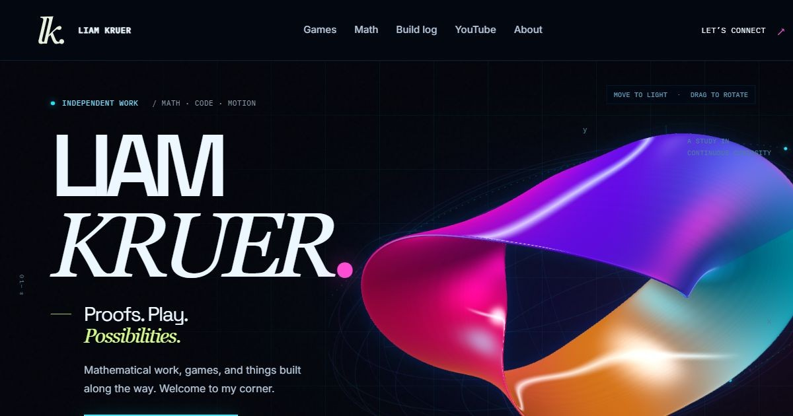

# Liam Kruer — Portfolio

A self-contained static portfolio. It needs no build step, application dependencies, account system, or runtime API keys.

[Visit the portfolio](https://liam-kruer-portfolio.mistydill33.chatgpt.site/)



## Preview

Run `npm start`, then open `http://127.0.0.1:4173`. Node.js 18 or newer is sufficient. Deploy the `dist` folder on any static host.

```sh
git clone https://github.com/lkruer/liam-kruer-portfolio.git
cd liam-kruer-portfolio
npm start
```

No dependency installation is required. Set `PORT` to use another port and `HOST` to change the bind address. Local previews use `127.0.0.1` by default.

## Replit

Import this GitHub repository into Replit and select **Run**. The included `.replit` file supplies the Node.js runtime, run command, and port mapping. It sets `HOST=0.0.0.0` so the preview can reach the server. See [Replit's GitHub import guide](https://docs.replit.com/build/import-from-providers) for the import flow.

The complete website is in `dist/`, including the game, paper previews, PDFs, downloads, fonts, and logo. This repository is a standalone copy of the portfolio and does not contain the hosting account's configuration or credentials.

## Make it yours

- **Add games:** append an entry with `id`, `title`, `subtitle`, `year`, `platform`, and `playUrl` to the `games` array in `dist/content.js`. The Games shelf and game count update automatically. The game opens in the on-site player; `playUrl` can point to a folder hosted with the portfolio. Sundrift has a separate featured presentation in `dist/index.html`.
- **Edit build notes:** update `articles` in `dist/content.js`. The dialog system handles presentation and keyboard dismissal.
- **Edit biography, videos, or links:** update `dist/index.html`.
- **Personal logo:** `dist/assets/brand/liam-kruer-mark.svg` is the shared, outlined `lk.` monogram used in the header, footer, and About orbit. The cream mark (`#e7efdf`) stays transparent and needs no installed font. Keep its square canvas and aspect ratio intact. Browser and Apple icons use the same mark on an ink background.
- **Edit paper cards:** original file paths and page counts live in `dist/research-catalog.js`; short summaries and topics live in `dist/paper-notes.js`. Run `npm run render:papers` after updating either. This writes each card into the HTML, so visitors can browse the full collection without opening the reader or waiting for JavaScript to render the cards.
- **Change colors, spacing, or breakpoints:** the base is in `dist/styles.css`, the neon palette and wireframes are in `dist/neon.css`, reader styles are in `dist/work.css`, and the editorial layout and paper cards are in `dist/fieldnotes.css`.
- **Reading typography:** Inter handles body copy, IBM Plex Mono handles technical labels, and Space Grotesk with serif accents handles display type. Paper summaries use 17px text; download controls have 52–55px minimum heights. The reading-scale rules at the end of `dist/fieldnotes.css` keep mobile text large and stack paper actions when needed.
- **Navigation and layout:** the narrow-screen menu includes Connect, and paper filters stay visible within the archive. Image aspect ratios reserve their space before loading, so section links do not shift as previews arrive. The featured Sundrift project is not repeated in the game shelf; future games appear there automatically.
- **Readers and media:** papers use a single main scroll area with sticky page controls; zoom enables panning. Videos preserve a 16:9 frame and use a compact viewing dialog; games retain a larger interactive player. Only one dialog is open at a time, including when using the keyboard jump menu.
- **Hero sculpture:** `dist/sculpture-webgl.js` generates a thin twisted ribbon with broad faces, a rounded edge, smooth normals, and procedural reflections. Lighting and rotation respond to the pointer; dragging rotates the form. Three ribbon variations and a wireframe toggle are included. Motion pauses offscreen and behind dialogs, respects reduced-motion preferences, and falls back to the 2D renderer in `dist/sculpture.js` if WebGL is unavailable.
- **Research collection:** all 12 papers have a large, upright preview of the entire first page, short summary, topic, draft status, coauthor credit, and direct PDF/source downloads. Preview frames fit each document without cropping. Search and Erdős/Green filters narrow the collection. The reader has 109 local page previews, page text, zoom, pagination, and available Lean downloads. `dist/work.js` handles filters, reading, and media playback; originals live in `dist/assets/work/`.
- **Sundrift:** the original browser-game files are hosted in `dist/games/sundrift/` and are loaded only when the player opens. The source ZIP includes the game and its original development notes.
- **Math demo:** `dist/math.js` uses exact BigInt steps. It accepts whole numbers from 1 to 999,999 and has a 3,000-step cap.

The keyboard jump menu opens with Ctrl+K (Command+K on a Mac); it supports searching, Enter, arrow keys, and Escape. Build-note dialogs also close with Escape.

## Content and assets

Facts are grounded in Liam's request and public sources, checked October 15, 2026:

- https://github.com/lkruer/sundrift — game, implementation description, AI-tooling attribution, and development record. The featured image is a staged nighttime render of the original Neo Tokyo scene and pearl-white car. A temporary local capture variant omitted the menu texture and held the title camera still; the playable game source remains unchanged. The earlier title screenshot is retained among the assets.
- https://github.com/lkruer/erdos-96-97-proof — collaborative, unpublished manuscript and Lean work. Coauthors Jensen Kohlmeyer and Liam Price are credited. The portfolio does not claim peer review or an independently confirmed solution.
- https://github.com/lkruer/conjectures — draft mathematical manuscripts and exploratory formalizations.
- https://www.linkedin.com/in/liamkruer — SOLIDWORKS certifications, PLTW engineering, student media, and tennis. Purdue freshman status comes directly from Liam.
- https://www.youtube.com/@liamkruer — three verified video titles, links, durations, and original video thumbnails.

Hazard Watch is intentionally excluded. No private repository content is included. The engineering notes summarize existing public Sundrift documentation; no CAD projects, awards, or employment history are invented.

Inter, IBM Plex Mono, Space Grotesk, and the retained DM Sans font files are self-hosted Google Fonts under their included Open Font Licenses. Portfolio graphics are generated by the site. Paper previews and downloads are served locally. Opening the game loads its original Three.js and font dependencies from public CDNs; opening a video loads YouTube's privacy-enhanced player.

The existing portfolio is published with Sites. Publishing this repository elsewhere does not automatically update that deployment.
