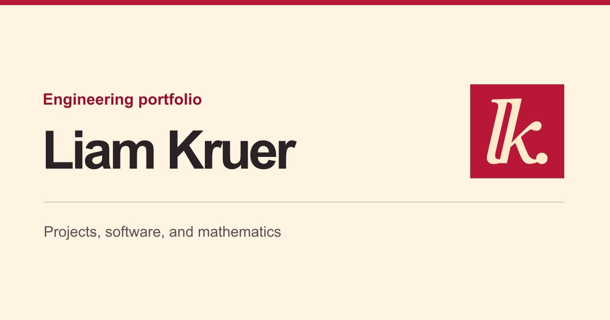

# Liam Kruer — Portfolio

A self-contained static portfolio. It needs no build step, application dependencies, account system, or runtime API keys.

[Visit the portfolio](https://liamkruer.com/)



## Preview

Run `npm start`, then open `http://127.0.0.1:4173`. Node.js 18 or newer is sufficient. Deploy the `dist` folder on any static host.

```sh
git clone https://github.com/lkruer/liam-kruer-portfolio.git
cd liam-kruer-portfolio
npm start
```

No dependency installation is required. Set `PORT` to use another port and `HOST` to change the bind address. Local previews use `127.0.0.1` by default.

## Replit

Import this GitHub repository into Replit and select **Run**. The included `.replit` file supplies the Node.js runtime, run command, and port mapping. It sets `HOST=0.0.0.0` so the preview can reach the server. See [Replit's GitHub import guide](https://docs.replit.com/build/import-from-providers) for the import flow.

The complete website is in `dist/`, including the game, paper previews, PDFs, downloads, fonts, and logo. This repository is a standalone copy of the portfolio and does not contain the hosting account's configuration or credentials.

## Make it yours

- **Add games:** append an entry with `id`, `title`, `subtitle`, `year`, `platform`, and `playUrl` to the `games` array in `dist/content.js`. Additional games appear in the Games section. The game opens in the on-site player; `playUrl` can point to a folder hosted with the portfolio. Sundrift has a separate featured presentation in `dist/index.html`.
- **Edit build notes:** update `articles` in `dist/content.js`. The dialog system handles presentation and keyboard dismissal.
- **Edit biography, videos, or links:** update `dist/index.html`.
- **Personal logo:** `dist/assets/brand/lk-racing-red.svg` is the cream `lk.` monogram on racing red. The same colors appear in the mobile home-screen icon and the social preview.
- **Edit the paper index:** original file paths and page counts live in `dist/research-catalog.js`; short summaries and topics live in `dist/paper-notes.js`. Run `npm run render:papers` after updating either. This writes each paper row into the HTML, so visitors can browse and download the papers without waiting for JavaScript.
- **Update Hexagon preprints:** `dist/hexagon-research.js` contains the verified November 2026 bibliography. The original records remain the source for contributor credit, provenance, and version history. Local PDFs, source downloads, and reader previews are in `dist/assets/work/hexagon/`. Run `npm run render:papers` after updating the bibliography.
- **Change colors, spacing, or breakpoints:** update `dist/portfolio.css`. The palette is defined in the variables at the top and the typography uses the self-hosted Inter font.
- **Navigation and layout:** Engineering, Research, and Games each have their own section. The main navigation collapses into a menu on narrow screens.
- **Readers and media:** papers use a single main scroll area with sticky page controls; zoom enables panning. Videos preserve a 16:9 frame and use a compact viewing dialog; games retain a larger interactive player. Close the reader and note dialogs with Escape.
- **Research collection:** one search covers the Hexagon submissions, other Hexagon contributions, and working manuscripts. All papers have a direct PDF link. The original manuscripts and six Hexagon submissions also have an on-site reader with summaries, credits, page previews, text, and source files. Available Lean files are linked from the reader.
- **Sundrift:** the original browser-game files are hosted in `dist/games/sundrift/` and are loaded only when the player opens. The source ZIP includes the game and its original development notes.
- **Math demo:** `dist/math.js` uses exact BigInt steps. It accepts whole numbers from 1 to 999,999 and has a 3,000-step cap.


## Content and assets

Facts are grounded in Liam's request and public sources, checked October 15, 2026:

- https://github.com/lkruer/sundrift — game, implementation description, AI-tooling attribution, and development record. The featured image is a staged nighttime render of the original Neo Tokyo scene and pearl-white car. A temporary local capture variant omitted the menu texture and held the title camera still; the playable game source remains unchanged. The earlier title screenshot is retained among the assets.
- https://github.com/lkruer/erdos-96-97-proof — collaborative, unpublished manuscript and Lean work. Coauthors Jensen Kohlmeyer and Liam Price are credited. The portfolio does not claim peer review or an independently confirmed solution.
- https://github.com/lkruer/conjectures — draft mathematical manuscripts and exploratory formalizations.
- https://www.linkedin.com/in/liamkruer — SOLIDWORKS certifications, PLTW engineering, student media, and tennis. Purdue freshman status comes directly from Liam.
- https://www.youtube.com/@liamkruer — four verified video titles, links, durations, and original thumbnails. The circle-packing video was added in November 2026.

Hazard Watch is intentionally excluded. No private repository content is included. The engineering notes summarize existing public Sundrift documentation; no CAD projects, awards, or employment history are invented.

Inter, IBM Plex Mono, Space Grotesk, and the retained DM Sans font files are self-hosted Google Fonts under their included Open Font Licenses. Portfolio graphics are generated by the site. Paper previews and downloads are served locally. Opening the game loads its original Three.js and font dependencies from public CDNs; opening a video loads YouTube's privacy-enhanced player.

The primary portfolio is published through Replit at https://liamkruer.com/. Sync this repository into the Replit project and republish to update that deployment. The earlier Sites copy is a separate deployment.
